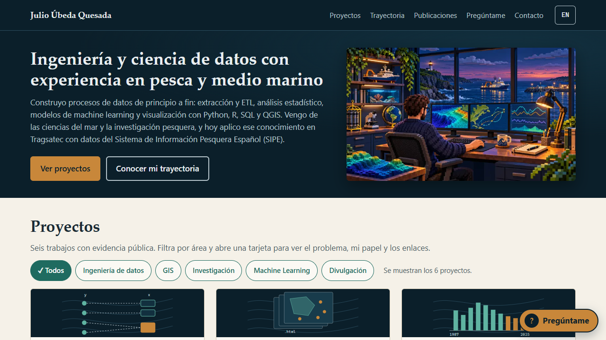

<div align="center">


# Portfolio de Julio Úbeda Quesada

Portfolio profesional bilingüe sobre ingeniería y ciencia de datos aplicadas a la pesca y al medio marino.

[](https://juliouq.github.io/Portfolio-Web---JulioUQ/es/)

  



</div>

---

## Descripción general

Sitio estático en español e inglés ([versión en inglés](https://juliouq.github.io/Portfolio-Web---JulioUQ/en/)) que reúne los proyectos, la trayectoria y las publicaciones. Cada proyecto tiene un caso de estudio que separa el trabajo en equipo de la contribución individual y enlaza a su código, publicación o demo.

## Funcionalidades

- **Proyectos** filtrables por área, con casos de estudio detallados.
- **Trayectoria** en una cronología interactiva.
- **Publicaciones** científicas y comunicaciones en congresos.
- **Demos** integradas: mapa generado con la aplicación de mapas y gráfico interactivo de la flota.
- **Accesibilidad:** navegación por teclado, diálogos nativos y contenido equivalente en ambos idiomas.

## Tecnologías y herramientas

| Ámbito | Herramientas |
| --- | --- |
| Sitio | Astro, TypeScript |
| Publicación | GitHub Actions, GitHub Pages |

## Instalación y uso

```bash
npm install
npm run dev      # desarrollo en http://localhost:4321
npm run build    # sitio estático en dist/
```

## Autor

**Julio Úbeda Quesada** · Data Scientist

[](https://juliouq.github.io/Portfolio-Web---JulioUQ/es/) [](https://www.linkedin.com/in/juliouq/) [](https://github.com/JulioUQ)
